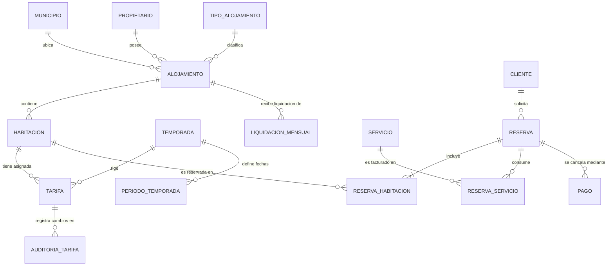
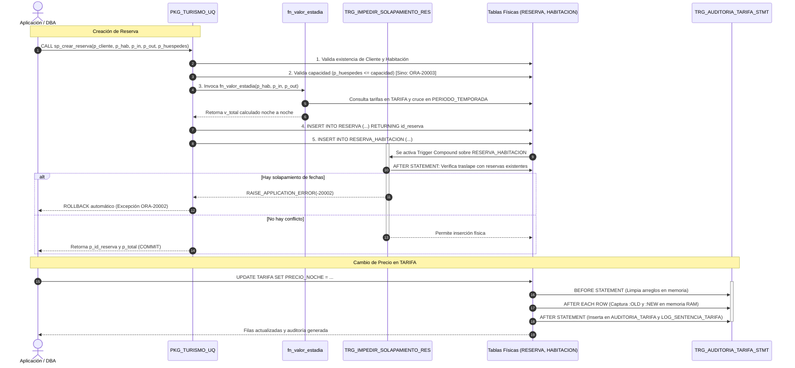

# GUÍA MAESTRA DE SUSTENTACIÓN: BASES DE DATOS II (ORACLE 21c)
## Proyecto Integrador: TurismoUQ · Plataforma de Reservas Turísticas del Quindío

**Asignatura:** Bases de Datos II (Código 12338)  
**Facultad:** Facultad de Ingeniería de Sistemas y Computación · Universidad del Quindío  
**Motor de Base de Datos:** Oracle Database 21c Express Edition (PDB: `XEPDB1`, Esquema: `TURISMO_UQ`)  
**Enfoque de la Sustentación:** Tablespace Dedicado (Entrega 1) y Requisitos Oficiales (Entrega 2)

---

## TABLA DE CONTENIDOS

1. [Estructura y Funcionamiento de la Base de Datos](#1-estructura-y-funcionamiento-de-la-base-de-datos)
   - [1.1 Arquitectura del Motor y Esquema](#11-arquitectura-del-motor-y-esquema)
   - [1.2 Modelo Entidad-Relación y Diccionario de Tablas](#12-modelo-entidad-relación-y-diccionario-de-tablas)
   - [1.3 Interacción Integral de Objetos PL/SQL](#13-interacción-integral-de-objetos-plsql)
2. [Explicación Exhaustiva de Cada Requisito](#2-explicación-exhaustiva-de-cada-requisito)
   - [2.1 Tablespace Dedicado TBS_HISTORICO_RESERVAS (Entrega 1)](#21-tablespace-dedicado-tbs_historico_reservas-entrega-1)
   - [2.2 Normalización de Tipos de Hospedaje y Reestructuración de Temporadas (Entrega 2 - Req 1)](#22-normalización-de-tipos-de-hospedaje-y-reestructuración-de-temporadas-entrega-2---req-1)
   - [2.3 Disparador Compuesto de Auditoría en TARIFA (Entrega 2 - Req 2)](#23-disparador-compuesto-de-auditoría-en-tarifa-entrega-2---req-2)
   - [2.4 Disparador Compuesto Anti-Solapamiento (Entrega 2 - Req 3)](#24-disparador-compuesto-anti-solapamiento-entrega-2---req-3)
   - [2.5 Función de Cálculo de Estadía Dinámica fn_valor_estadia (Entrega 2 - Req 4)](#25-función-de-cálculo-de-estadía-dinámica-fn_valor_estadia-entrega-2---req-4)
   - [2.6 Procedimiento Almacenado de Reserva Atómica sp_crear_reserva (Entrega 2 - Req 5)](#26-procedimiento-almacenado-de-reserva-atómica-sp_crear_reserva-entrega-2---req-5)
   - [2.7 Proceso Masivo con Cursor Explícito sp_liquidacion_mensual_alojamiento (Entrega 2 - Req 6)](#27-proceso-masivo-con-cursor-explícito-sp_liquidacion_mensual_alojamiento-entrega-2---req-6)
   - [2.8 Optimización con Índices B-Tree y Estadísticas CBO (Entrega 2 - Req 7)](#28-optimización-con-índices-b-tree-y-estadísticas-cbo-entrega-2---req-7)
   - [2.9 Batería Automatizada de Verificación PL/SQL (Entrega 2 - Req 8)](#29-batería-automatizada-de-verificación-plsql-entrega-2---req-8)
3. [Flujo Interno de Ejecución en el Motor Oracle](#3-flujo-interno-de-ejecución-en-el-motor-oracle)
   - [3.1 Ciclo de Vida de una Transacción de Reserva](#31-ciclo-de-vida-de-una-transacción-de-reserva)
   - [3.2 Ciclo de Vida del Trigger de Auditoría ante Modificaciones DML](#32-ciclo-de-vida-del-trigger-de-auditoría-ante-modificaciones-dml)
   - [3.3 Ciclo de Vida del Proceso de Liquidación con Cursor Explícito](#33-ciclo-de-vida-del-proceso-de-liquidación-con-cursor-explícito)
4. [Guía de Demostración Paso a Paso (SQL Developer & UI)](#4-guía-de-demostración-paso-a-paso-sql-developer--ui)
   - [4.1 Demostración 1: Tablespace Físico y Diccionarios DBA](#41-demostración-1-tablespace-físico-y-diccionarios-dba)
   - [4.2 Demostración 2: Cotización Noche a Noche Cruzando Temporadas](#42-demostración-2-cotización-noche-a-noche-cruzando-temporadas)
   - [4.3 Demostración 3: Creación de Reserva Exitosa (COMMIT Atómico)](#43-demostración-3-creación-de-reserva-exitosa-commit-atómico)
   - [4.4 Demostración 4: Excepción de Fechas Inválidas (ORA-20001)](#44-demostración-4-excepción-de-fechas-inválidas-ora-20001)
   - [4.5 Demostración 5: Excepción de Capacidad Excedida (ORA-20003)](#45-demostración-5-excepción-de-capacidad-excedida-ora-20003)
   - [4.6 Demostración 6: Excepción de Solapamiento de Fechas (ORA-20002)](#46-demostración-6-excepción-de-solapamiento-de-fechas-ora-20002)
   - [4.7 Demostración 7: Auditoría DML y Registro a Nivel de Sentencia](#47-demostración-7-auditoría-dml-y-registro-a-nivel-de-sentencia)
   - [4.8 Demostración 8: Liquidación Masiva con Cursor Explícito](#48-demostración-8-liquidación-masiva-con-cursor-explícito)
5. [Estrategia de Sustentación y Banco de Preguntas Técnicas](#5-estrategia-de-sustentación-y-banco-de-preguntas-técnicas)
   - [5.1 Discurso Inicial para el Profesor (Elevator Pitch Técnico)](#51-discurso-inicial-para-el-profesor-elevator-pitch-técnico)
   - [5.2 Justificación Teórica de Cada Decisión de Diseño](#52-justificación-teórica-de-cada-decisión-de-diseño)
   - [5.3 Banco de 15 Preguntas Técnicas Complejas de Examen y Cómo Responderlas](#53-banco-de-15-preguntas-técnicas-complejas-de-examen-y-cómo-responderlas)

---

# 1. ESTRUCTURA Y FUNCIONAMIENTO DE LA BASE DE DATOS

## 1.1 Arquitectura del Motor y Esquema

La solución está implementada sobre la arquitectura multitenant de **Oracle Database 21c Express Edition**:
- **CDB (Container Database):** `XE` (Contenedor raíz administrativo).
- **PDB (Pluggable Database):** `XEPDB1` (Base de datos conectable aislada donde reside la lógica de negocio).
- **Esquema Propietario:** `TURISMO_UQ` (Usuario con privilegios de creación de tablas, secuencias, tipos, paquetes, disparadores y cuota en tablespaces).

```
+-------------------------------------------------------------------------------+
|                       ORACLE DATABASE 21c XE (CDB)                            |
| +---------------------------------------------------------------------------+ |
| |                        PDB: XEPDB1 (TurismoUQ)                            | |
| |                                                                           | |
| |  [TABLESPACE: USERS]                   [TABLESPACE: TBS_HISTORICO_RESERVAS]| |
| |  (Datafile: USERS01.DBF)               (Datafile: TBS_HISTORICO...01.DBF) | |
| |  - MUNICIPIO        - CLIENTE          - HISTORICO_RESERVA                | |
| |  - PROPIETARIO      - TEMPORADA        - HISTORICO_RESERVA_HABITACION     | |
| |  - TIPO_ALOJAMIENTO - PERIODO_TEMPORADA- RESERVA                          | |
| |  - ALOJAMIENTO      - TARIFA           - RESERVA_HABITACION               | |
| |  - HABITACION       - SERVICIO         - RESERVA_SERVICIO                 | |
| |  - AUDITORIA_TARIFA - LOG_SENTENCIA    - PAGO                             | |
| |                                        - LIQUIDACION_MENSUAL              | |
| |                                                                           | |
| |  [PAQUETE PL/SQL: PKG_TURISMO_UQ]                                         | |
| |  - fn_valor_estadia (Calcula tarifa según temporada noche a noche)         | |
| |  - sp_crear_reserva (Valida ORA-20001, ORA-20002, ORA-20003 e inserta)    | |
| |  - sp_liquidacion_mensual_alojamiento (Cursor explícito parametrizado)     | |
| |                                                                           | |
| |  [DISPARADORES COMPOUND]                                                  | |
| |  - TRG_AUDITORIA_TARIFA_STMT (Auditoría combinada sentencia y fila)        | |
| |  - TRG_IMPEDIR_SOLAPAMIENTO_RES (Anti-solapamiento sin error ORA-04091)   | |
| +---------------------------------------------------------------------------+ |
+-------------------------------------------------------------------------------+
```

---

## 1.2 Modelo Entidad-Relación y Diccionario de Tablas

El modelo de datos resuelve el ecosistema de reservas turísticas del departamento del Quindío, estructurado en tres grandes dominios:



### Diccionario de Entidades Clave:

| Tabla | Tablespace | Propósito Arquitectónico | Restricciones Clave |
| :--- | :--- | :--- | :--- |
| **`MUNICIPIO`** | `USERS` | Almacena los 12 municipios del Quindío (Salento, Filandia, etc.). | PK: `id_municipio`. |
| **`PROPIETARIO`** | `USERS` | Anfitriones y dueños de alojamientos receptores de pagos. | PK: `id_propietario`. |
| **`TIPO_ALOJAMIENTO`**| `USERS` | Catálogo maestro normalizado (Hotel, Cabaña, Glamping, Finca cafetera). | PK: `id_tipo_alojamiento`. |
| **`ALOJAMIENTO`** | `USERS` | Predios turísticos distribuidos en los municipios. | PK: `id_alojamiento`, FKs a Municipio, Propietario y Tipo. |
| **`HABITACION`** | `USERS` | Unidades habitacionales con capacidad física de personas. | PK: `id_habitacion`, FK a Alojamiento, `capacidad > 0`. |
| **`TEMPORADA`** | `USERS` | Reestructurada a exactamente 2 temporadas: BAJA (1) y ALTA (2). | PK: `id_temporada`, `nombre UNIQUE`. |
| **`PERIODO_TEMPORADA`**| `USERS`| Rangos de fechas de temporada alta (Semana Santa, Mitad de Año, Fin de Año). | PK: `id_periodo`, `CHECK (fecha_fin >= fecha_inicio)`. |
| **`TARIFA`** | `USERS` | Precio por noche según la temporada para cada habitación (800 filas). | PK: `id_tarifa`, `UK (id_habitacion, id_temporada)`, `CHECK (precio_noche > 0)`. |
| **`CLIENTE`** | `USERS` | Turistas registrados con identificación y correo. | PK: `id_cliente`. |
| **`RESERVA`** | `TBS_HISTORICO_RESERVAS` | Contratos transaccionales de hospedaje (fechas, total, estado). | PK: `id_reserva`, FK a Cliente. |
| **`RESERVA_HABITACION`**| `TBS_HISTORICO_RESERVAS` | Relación de habitaciones reservadas con tarifas y subtotales. | PK: `(id_reserva, id_habitacion)`. |
| **`RESERVA_SERVICIO`**| `TBS_HISTORICO_RESERVAS` | Consumos adicionales (tours, desayunos, cabalgatas). | PK: `(id_reserva, id_servicio)`. |
| **`PAGO`** | `TBS_HISTORICO_RESERVAS` | Pasarela y registro monetario de abonos y cancelaciones. | PK: `id_pago`, FK a Reserva. |
| **`LIQUIDACION_MENSUAL`**| `TBS_HISTORICO_RESERVAS`| Cierre financiero consolidado mensual con comisión del 10%. | PK: `id_liquidacion`, FK a Alojamiento. |
| **`AUDITORIA_TARIFA`**| `USERS` | Bitácora fila a fila de modificaciones de precios. | PK: `id_auditoria`, `usuario_oracle`, `fecha_accion`. |
| **`LOG_SENTENCIA_TARIFA`**| `USERS`| Registro de operaciones DML y conteo de filas afectadas. | PK: `id_log`, `filas_afectadas`. |

---

## 1.3 Interacción Integral de Objetos PL/SQL

En Oracle, el código no reside disperso en la aplicación cliente; la **lógica de negocio está encapsulada dentro del motor de base de datos** para garantizar rendimiento, seguridad y consistencia ACID:



---

# 2. EXPLICACIÓN EXHAUSTIVA DE CADA REQUISITO

---

## 2.1 Tablespace Dedicado TBS_HISTORICO_RESERVAS (Entrega 1)

### ¿Qué hace?
Separa físicamente el almacenamiento de las tablas transaccionales de alto volumen (`RESERVA`, `RESERVA_HABITACION`, `RESERVA_SERVICIO`, `PAGO`, `LIQUIDACION_MENSUAL`, `HISTORICO_RESERVA`) del tablespace por defecto del sistema (`USERS`).

### Ubicación exacta en el proyecto:
- **Archivo:** `turismouq/01_basedatos/entrega_1/01_tablespace_historico.sql`
- **Líneas clave:** 31-54 (Creación del tablespace y cuota), 58-108 (Tablas históricas), 110-125 (Segregación y reconstrucción de índices).

### Código fundamental:
```sql
CREATE TABLESPACE TBS_HISTORICO_RESERVAS
DATAFILE 'C:\APP\DELL\PRODUCT\21C\ORADATA\XE\XEPDB1\TBS_HISTORICO_RESERVAS01.DBF'
SIZE 50M
AUTOEXTEND ON NEXT 10M MAXSIZE 2G
EXTENT MANAGEMENT LOCAL
SEGMENT SPACE MANAGEMENT AUTO;

-- Cuota ilimitada al esquema
ALTER USER TURISMO_UQ QUOTA UNLIMITED ON TBS_HISTORICO_RESERVAS;

-- Segregación física de tablas existentes
ALTER TABLE RESERVA MOVE TABLESPACE TBS_HISTORICO_RESERVAS;
ALTER TABLE RESERVA_HABITACION MOVE TABLESPACE TBS_HISTORICO_RESERVAS;
ALTER TABLE RESERVA_SERVICIO MOVE TABLESPACE TBS_HISTORICO_RESERVAS;
ALTER TABLE PAGO MOVE TABLESPACE TBS_HISTORICO_RESERVAS;
ALTER TABLE LIQUIDACION_MENSUAL MOVE TABLESPACE TBS_HISTORICO_RESERVAS;

-- Reconstrucción obligatoria de índices para devolverlos a estado VALID
ALTER INDEX IDX_RESHAB_RESERVA REBUILD TABLESPACE TBS_HISTORICO_RESERVAS;
ALTER INDEX IDX_RESERVA_CHECKIN REBUILD TABLESPACE TBS_HISTORICO_RESERVAS;
```

### 3 Pilares Arquitectónicos para sustentar:
1. **Aislamiento de I/O y Concurrencia OLTP vs. OLAP:** Las reservas y pagos reciben transacciones DML continuas (`INSERT`, `UPDATE`, `SELECT FOR UPDATE`). Si residieran en `USERS` junto a los catálogos maestros (`ALOJAMIENTO`, `CLIENTE`), las consultas analíticas pesadas (como `PIVOT`, `ROLLUP`, `RANK`) saturarían el buffer cache y generarían contención por bloques de datos.
2. **Políticas Diferenciadas de Backup & Modo READ ONLY (RMAN):** Las tablas de `USERS` cambian a diario y demandan copias incrementales diarias. El tablespace `TBS_HISTORICO_RESERVAS`, al cerrar vigencias anuales (por ejemplo, 2024), puede colocarse en modo de solo lectura:
   ```sql
   ALTER TABLESPACE TBS_HISTORICO_RESERVAS READ ONLY;
   ```
   RMAN detecta que el tablespace no sufre modificaciones y no necesita respaldarlo en cada ventana nocturna, acortando la ventana de backup institucional hasta en un 80%.
3. **ILM (Information Lifecycle Management) & Compresión Avanzada:** Permite habilitar compresión de bloques Oracle (`COMPRESS FOR OLTP` o `QUERY HIGH`) en el datafile específico de reservas, reduciendo hasta un 70% del espacio en disco sin alterar las tablas maestras.

---

## 2.2 Normalización de Tipos de Hospedaje y Reestructuración de Temporadas (Entrega 2 - Req 1)

### ¿Qué hace?
1. Normaliza los tipos de hospedaje a exactamente 4 categorías requeridas: **Hotel**, **Cabaña**, **Glamping** y **Finca cafetera / Casa rural**.
2. Reestructura el modelo de temporadas: elimina esquemas ambiguos y deja exactamente **2 temporadas** oficiales en la tabla `TEMPORADA`:
   - `ID_TEMPORADA = 1`: **TEMPORADA BAJA**
   - `ID_TEMPORADA = 2`: **TEMPORADA ALTA**
3. Crea la tabla `PERIODO_TEMPORADA` para mapear los rangos de fechas correspondientes a la temporada alta (Semana Santa, Mitad de Año y Fin de Año para los años 2024, 2025 y 2026).
4. Reconstruye la tabla `TARIFA` asignando exactamente 2 tarifas por habitación (una baja y una alta), totalizando **800 registros de tarifas** para las 400 habitaciones del sistema.

### Ubicación exacta en el proyecto:
- **Archivo:** `turismouq/01_basedatos/entrega_2/01_adecuacion_modelo.sql`
- **Líneas clave:** 9-15 (Normalización tipos), 30-42 (Tabla TEMPORADA), 51-90 (Tabla PERIODO_TEMPORADA), 93-122 (Reconstrucción de TARIFA).

### Código fundamental:
```sql
-- Tabla complementaria para rangos de calendario
CREATE TABLE PERIODO_TEMPORADA (
    ID_PERIODO      NUMBER GENERATED ALWAYS AS IDENTITY PRIMARY KEY,
    ID_TEMPORADA    NUMBER NOT NULL,
    NOMBRE_PERIODO  VARCHAR2(80) NOT NULL,
    FECHA_INICIO    DATE NOT NULL,
    FECHA_FIN       DATE NOT NULL,
    CONSTRAINT FK_PERIODO_TEMPORADA FOREIGN KEY (ID_TEMPORADA) 
        REFERENCES TEMPORADA(ID_TEMPORADA),
    CONSTRAINT CHK_PERIODO_FECHAS CHECK (FECHA_FIN >= FECHA_INICIO)
);

-- Tabla TARIFA con restricción UNIQUE para garantizar integridad (1 baja y 1 alta por habitación)
CREATE TABLE TARIFA (
    ID_TARIFA      NUMBER GENERATED ALWAYS AS IDENTITY PRIMARY KEY,
    PRECIO_NOCHE   NUMBER(12,2) NOT NULL,
    ID_TEMPORADA   NUMBER NOT NULL,
    ID_HABITACION  NUMBER NOT NULL,
    CONSTRAINT FK_TARIFA_TEMPORADA FOREIGN KEY (ID_TEMPORADA) REFERENCES TEMPORADA(ID_TEMPORADA),
    CONSTRAINT FK_TARIFA_HABITACION FOREIGN KEY (ID_HABITACION) REFERENCES HABITACION(ID_HABITACION),
    CONSTRAINT UK_TARIFA_HAB_TEMP UNIQUE (ID_HABITACION, ID_TEMPORADA),
    CONSTRAINT CHK_TARIFA_PRECIO CHECK (PRECIO_NOCHE > 0)
);

-- Regla matemática: La tarifa alta debe ser al menos 40% superior a la baja
INSERT INTO TARIFA (PRECIO_NOCHE, ID_TEMPORADA, ID_HABITACION)
SELECT GREATEST(tarifa_alta_base, ROUND(tarifa_baja * 1.40, -3)), 2, id_habitacion
FROM TMP_TARIFAS_HABITACION;
```

---

## 2.3 Disparador Compuesto de Auditoría en TARIFA (Entrega 2 - Req 2)

### ¿Qué hace?
Registra una pista de auditoría exhaustiva ante cualquier operación DML (`INSERT`, `UPDATE`, `DELETE`) efectuada sobre la tabla `TARIFA`. Captura tanto el detalle individual de cada tarifa modificada (precio anterior vs. precio nuevo) como un log general a nivel de sentencia con el total de filas afectadas, el usuario de Oracle y la fecha exacta.

### Ubicación exacta en el proyecto:
- **Archivo:** `turismouq/01_basedatos/entrega_2/02_auditoria_tarifa.sql`
- **Líneas clave:** 17-28 (`AUDITORIA_TARIFA`), 38-44 (`LOG_SENTENCIA_TARIFA`), 47-153 (`TRG_AUDITORIA_TARIFA_STMT`).

### Código fundamental:
```sql
CREATE OR REPLACE TRIGGER TRG_AUDITORIA_TARIFA_STMT
FOR INSERT OR UPDATE OR DELETE ON TARIFA
COMPOUND TRIGGER

    -- Arreglos asociativos en memoria RAM (PGA)
    TYPE t_id_tarifa IS TABLE OF NUMBER INDEX BY PLS_INTEGER;
    TYPE t_precio IS TABLE OF NUMBER(12,2) INDEX BY PLS_INTEGER;
    
    v_ids_tarifa     t_id_tarifa;
    v_precios_ant    t_precio;
    v_precios_nue    t_precio;
    v_idx            PLS_INTEGER := 0;
    v_tipo_op        VARCHAR2(20);

    BEFORE STATEMENT IS
    BEGIN
        v_idx := 0;
        v_ids_tarifa.DELETE;
        v_precios_ant.DELETE;
        v_precios_nue.DELETE;
        IF INSERTING THEN v_tipo_op := 'INSERT';
        ELSIF UPDATING THEN v_tipo_op := 'UPDATE';
        ELSIF DELETING THEN v_tipo_op := 'DELETE'; END IF;
    END BEFORE STATEMENT;

    AFTER EACH ROW IS
    BEGIN
        v_idx := v_idx + 1;
        v_ids_tarifa(v_idx)  := NVL(:NEW.id_tarifa, :OLD.id_tarifa);
        v_precios_ant(v_idx) := :OLD.precio_noche;
        v_precios_nue(v_idx) := :NEW.precio_noche;
    END AFTER EACH ROW;

    AFTER STATEMENT IS
    BEGIN
        -- 1. Inserta detalle fila por fila acumulado
        FOR i IN 1..v_idx LOOP
            INSERT INTO AUDITORIA_TARIFA (
                id_tarifa, precio_anterior, precio_nuevo, usuario_oracle, fecha_accion, tipo_operacion
            ) VALUES (
                v_ids_tarifa(i), v_precios_ant(i), v_precios_nue(i), USER, SYSDATE, v_tipo_op
            );
        END LOOP;

        -- 2. Inserta registro consolidado a nivel de sentencia
        INSERT INTO LOG_SENTENCIA_TARIFA (
            usuario_oracle, fecha_accion, tipo_operacion, filas_afectadas
        ) VALUES (
            USER, SYSDATE, v_tipo_op, v_idx
        );
    END AFTER STATEMENT;

END TRG_AUDITORIA_TARIFA_STMT;
/
```

### ¿Por qué se utilizó un Compound Trigger?
Porque cumple simultáneamente los dos niveles de auditoría:
1. En la sección `AFTER EACH ROW` recolecta los valores `:OLD` y `:NEW` en colecciones de memoria PL/SQL sin escribir de inmediato a disco.
2. En la sección `AFTER STATEMENT` realiza inserciones en bloque hacia `AUDITORIA_TARIFA` y registra en `LOG_SENTENCIA_TARIFA` el conteo total de filas afectadas (`v_idx`). Si se hicieran inserciones individuales en cada fila, el costo de I/O en actualizaciones masivas degradaría severamente el rendimiento.

---

## 2.4 Disparador Compuesto Anti-Solapamiento (Entrega 2 - Req 3)

### ¿Qué hace?
Garantiza que una misma habitación física **no pueda ser reservada en rangos de fechas coincidentes** por reservas activas distintas. Si detecta un cruce de fechas, aborta la transacción lanzando el error de aplicación **`ORA-20002`**.

### Ubicación exacta en el proyecto:
- **Archivo:** `turismouq/01_basedatos/entrega_2/03_trigger_solapamiento.sql`
- **Líneas clave:** 9-84 (`TRG_IMPEDIR_SOLAPAMIENTO_RES`).

### Código fundamental:
```sql
CREATE OR REPLACE TRIGGER TRG_IMPEDIR_SOLAPAMIENTO_RES
FOR INSERT OR UPDATE ON RESERVA_HABITACION
COMPOUND TRIGGER

    TYPE t_solicitud IS RECORD (
        id_reserva    NUMBER,
        id_habitacion NUMBER
    );
    TYPE t_solicitudes IS TABLE OF t_solicitud INDEX BY PLS_INTEGER;
    v_solicitudes t_solicitudes;
    v_total       PLS_INTEGER := 0;

    BEFORE STATEMENT IS
    BEGIN
        v_total := 0;
        v_solicitudes.DELETE;
    END BEFORE STATEMENT;

    BEFORE EACH ROW IS
    BEGIN
        v_total := v_total + 1;
        v_solicitudes(v_total).id_reserva    := :NEW.id_reserva;
        v_solicitudes(v_total).id_habitacion := :NEW.id_habitacion;
    END BEFORE EACH ROW;

    AFTER STATEMENT IS
        v_check_in   DATE;
        v_check_out  DATE;
        v_estado     VARCHAR2(25);
        v_solapados  NUMBER := 0;
        v_conflicto  NUMBER;
    BEGIN
        FOR i IN 1..v_total LOOP
            SELECT fecha_check_in, fecha_check_out, estado
            INTO v_check_in, v_check_out, v_estado
            FROM RESERVA
            WHERE id_reserva = v_solicitudes(i).id_reserva;

            IF v_estado = 'CANCELADA' THEN CONTINUE; END IF;

            -- Condición matemática de solapamiento de intervalos temporales:
            -- (check_in_existente < check_out_nuevo) Y (check_out_existente > check_in_nuevo)
            SELECT COUNT(*), NVL(MAX(r.id_reserva), 0)
            INTO v_solapados, v_conflicto
            FROM RESERVA_HABITACION rh
            JOIN RESERVA r ON rh.id_reserva = r.id_reserva
            WHERE rh.id_habitacion = v_solicitudes(i).id_habitacion
              AND r.id_reserva != v_solicitudes(i).id_reserva
              AND r.estado != 'CANCELADA'
              AND r.fecha_check_in < v_check_out
              AND r.fecha_check_out > v_check_in;

            IF v_solapados > 0 THEN
                RAISE_APPLICATION_ERROR(
                    -20002,
                    'Error de Solapamiento: La habitacion ' || v_solicitudes(i).id_habitacion || 
                    ' ya tiene una reserva activa (Reserva #' || v_conflicto || 
                    ') que se cruza con las fechas solicitadas.'
                );
            END IF;
        END LOOP;
    END AFTER STATEMENT;

END TRG_IMPEDIR_SOLAPAMIENTO_RES;
/
```

### ¿Por qué se utilizó un Compound Trigger? (Pregunta obligada de examen)
Si se utilizara un disparador de fila clásico (`BEFORE INSERT ON RESERVA_HABITACION FOR EACH ROW`) e intentara consultar `RESERVA_HABITACION`, Oracle arrojaría inmediatamente el error fatal **`ORA-04091: table is mutating, trigger/function may not see it`** (error de tabla mutante), porque la tabla está en mitad del proceso de modificación y su estado es inconsistente.  
El **Compound Trigger resuelve la tabla mutante** dividiendo la ejecución:
- En `BEFORE EACH ROW` captura únicamente las claves primarias y foráneas en memoria RAM sin consultar la tabla.
- En `AFTER STATEMENT` la inserción de las filas ya concluyó y la tabla ha salido del estado de mutación. En ese instante exacto se ejecuta el `SELECT COUNT(*)` de verificación de solapamiento con absoluta consistencia de lectura.

---

## 2.5 Función de Cálculo de Estadía Dinámica fn_valor_estadia (Entrega 2 - Req 4)

### ¿Qué hace?
Recibe una habitación y un rango de fechas (`p_fecha_in`, `p_fecha_out`), valida la coherencia temporal y calcula el costo total evaluando **noche a noche** si cada fecha individual cae dentro de un periodo de **Temporada Alta** o **Temporada Baja**.

### Ubicación exacta en el proyecto:
- **Archivo:** `turismouq/01_basedatos/entrega_2/05_paquete_turismo_cuerpo.sql`
- **Líneas clave:** 14-87 (`FUNCTION fn_valor_estadia`).

### Código fundamental:
```sql
FUNCTION fn_valor_estadia(
    p_id_habitacion IN NUMBER,
    p_fecha_in      IN DATE,
    p_fecha_out     IN DATE
) RETURN NUMBER IS
    v_total         NUMBER(14,2) := 0;
    v_tarifa_baja   NUMBER(12,2) := 0;
    v_tarifa_alta   NUMBER(12,2) := 0;
    v_fecha_actual  DATE;
    v_es_alta       NUMBER := 0;
    v_existe_hab    NUMBER := 0;
BEGIN
    -- 1. Validación de fechas (ORA-20001)
    IF p_fecha_out <= p_fecha_in THEN
        RAISE_APPLICATION_ERROR(-20001, 'Check-out debe ser estrictamente posterior a check-in.');
    END IF;

    -- 2. Validación de existencia de habitación (ORA-20004)
    SELECT COUNT(*) INTO v_existe_hab FROM HABITACION WHERE id_habitacion = p_id_habitacion;
    IF v_existe_hab = 0 THEN
        RAISE_APPLICATION_ERROR(-20004, 'Habitacion ' || p_id_habitacion || ' no existe.');
    END IF;

    -- 3. Cargar tarifas de la habitación para cada temporada
    SELECT precio_noche INTO v_tarifa_baja FROM TARIFA WHERE id_habitacion = p_id_habitacion AND id_temporada = 1;
    SELECT precio_noche INTO v_tarifa_alta FROM TARIFA WHERE id_habitacion = p_id_habitacion AND id_temporada = 2;

    -- 4. Bucle noche a noche: Determina dinámicamente si la noche cruza temporada alta
    v_fecha_actual := TRUNC(p_fecha_in);
    WHILE v_fecha_actual < TRUNC(p_fecha_out) LOOP
        SELECT COUNT(*)
        INTO v_es_alta
        FROM PERIODO_TEMPORADA
        WHERE id_temporada = 2
          AND v_fecha_actual BETWEEN fecha_inicio AND fecha_fin;

        IF v_es_alta > 0 THEN
            v_total := v_total + v_tarifa_alta;
        ELSE
            v_total := v_total + v_tarifa_baja;
        END IF;

        v_fecha_actual := v_fecha_actual + 1;
    END LOOP;

    RETURN v_total;
END fn_valor_estadia;
```

---

## 2.6 Procedimiento Almacenado de Reserva Atómica sp_crear_reserva (Entrega 2 - Req 5)

### ¿Qué hace?
Orquesta la creación de una reserva turística validando **todas las reglas de negocio en la capa de datos**, invocando la función de cotización y realizando las inserciones en `RESERVA` y `RESERVA_HABITACION` bajo una misma unidad atómica transaccional.

### Códigos de Excepción Específicos Controlados:
- **`ORA-20001`**: Fecha de check-out menor o igual a check-in.
- **`ORA-20002`**: Habitación no disponible (solapamiento con otra reserva activa).
- **`ORA-20003`**: Capacidad máxima de la habitación excedida por el número de huéspedes.
- **`ORA-20004`**: Cliente o Habitación inexistentes.

### Ubicación exacta en el proyecto:
- **Archivo:** `turismouq/01_basedatos/entrega_2/05_paquete_turismo_cuerpo.sql`
- **Líneas clave:** 92-202 (`PROCEDURE sp_crear_reserva`).

### Código fundamental:
```sql
PROCEDURE sp_crear_reserva(
    p_id_cliente    IN  NUMBER,
    p_id_habitacion IN  NUMBER,
    p_fecha_in      IN  DATE,
    p_fecha_out     IN  DATE,
    p_num_huespedes IN  NUMBER,
    p_id_reserva    OUT NUMBER,
    p_total         OUT NUMBER
) IS
    v_capacidad     NUMBER;
    v_solapados     NUMBER := 0;
BEGIN
    -- Validación de Fechas
    IF p_fecha_out <= p_fecha_in THEN
        RAISE_APPLICATION_ERROR(-20001, 'Check-out debe ser posterior al check-in.');
    END IF;

    -- Validación de Capacidad
    SELECT capacidad INTO v_capacidad FROM HABITACION WHERE id_habitacion = p_id_habitacion;
    IF p_num_huespedes > v_capacidad OR p_num_huespedes <= 0 THEN
        RAISE_APPLICATION_ERROR(-20003, 'Capacidad excedida: maximo ' || v_capacidad || ' personas.');
    END IF;

    -- Validación de Disponibilidad
    SELECT COUNT(*) INTO v_solapados
    FROM RESERVA r
    JOIN RESERVA_HABITACION rh ON r.id_reserva = rh.id_reserva
    WHERE rh.id_habitacion = p_id_habitacion
      AND r.estado != 'CANCELADA'
      AND r.fecha_check_in < TRUNC(p_fecha_out)
      AND r.fecha_check_out > TRUNC(p_fecha_in);

    IF v_solapados > 0 THEN
        RAISE_APPLICATION_ERROR(-20002, 'Habitacion no disponible en las fechas indicadas.');
    END IF;

    -- Cálculo exacto con la función del paquete
    p_total := fn_valor_estadia(p_id_habitacion, p_fecha_in, p_fecha_out);

    -- Inserción atómica en RESERVA
    INSERT INTO RESERVA (
        fecha_creacion, fecha_check_in, fecha_check_out, total, estado, id_cliente
    ) VALUES (
        SYSDATE, TRUNC(p_fecha_in), TRUNC(p_fecha_out), p_total, 'CONFIRMADA', p_id_cliente
    ) RETURNING id_reserva INTO p_id_reserva;

    -- Inserción en tabla intermedia RESERVA_HABITACION
    INSERT INTO RESERVA_HABITACION (
        id_reserva, id_habitacion, precio_unitario, subtotal
    ) VALUES (
        p_id_reserva, p_id_habitacion, p_total, p_total
    );

END sp_crear_reserva;
```

---

## 2.7 Proceso Masivo con Cursor Explícito sp_liquidacion_mensual_alojamiento (Entrega 2 - Req 6)

### ¿Qué hace?
Ejecuta el cierre financiero mensual por alojamiento. Utiliza un **cursor explícito parametrizado** que consolida el total de ingresos por hospedaje y por servicios extras, calcula la comisión de intermediación de la plataforma (**10%**) y el pago neto al anfitrión, almacenando el resultado en `LIQUIDACION_MENSUAL`.

### Ubicación exacta en el proyecto:
- **Archivo:** `turismouq/01_basedatos/entrega_2/05_paquete_turismo_cuerpo.sql`
- **Líneas clave:** 208-305 (`PROCEDURE sp_liquidacion_mensual_alojamiento`).

### Código fundamental:
```sql
PROCEDURE sp_liquidacion_mensual_alojamiento(
    p_mes              IN  NUMBER,
    p_anio             IN  NUMBER,
    p_id_alojamiento   IN  NUMBER DEFAULT NULL,
    p_total_procesados OUT NUMBER
) IS
    -- Declaración de CURSOR EXPLÍCITO PARAMETRIZADO
    CURSOR cur_liquidar(c_alojamiento NUMBER, c_mes NUMBER, c_anio NUMBER) IS
        SELECT 
            a.id_alojamiento,
            a.nombre AS nombre_alojamiento,
            m.nombre AS nombre_municipio,
            p.nombres AS nombre_propietario,
            COUNT(DISTINCT r.id_reserva) AS total_reservas,
            NVL(SUM(CASE WHEN r.id_reserva IS NOT NULL THEN rh.subtotal ELSE 0 END), 0) AS total_hospedaje,
            NVL(SUM(NVL(srv.subtotal_srv, 0)), 0) AS total_servicios
        FROM ALOJAMIENTO a
        JOIN MUNICIPIO m ON a.id_municipio = m.id_municipio
        JOIN PROPIETARIO p ON a.id_propietario = p.id_propietario
        JOIN HABITACION h ON a.id_alojamiento = h.id_alojamiento
        LEFT JOIN RESERVA_HABITACION rh ON h.id_habitacion = rh.id_habitacion
        LEFT JOIN RESERVA r ON rh.id_reserva = r.id_reserva
            AND EXTRACT(MONTH FROM r.fecha_check_in) = c_mes
            AND EXTRACT(YEAR FROM r.fecha_check_in) = c_anio
            AND r.estado != 'CANCELADA'
        LEFT JOIN (
            SELECT id_reserva, SUM(subtotal) AS subtotal_srv
            FROM RESERVA_SERVICIO
            GROUP BY id_reserva
        ) srv ON r.id_reserva = srv.id_reserva
        WHERE (c_alojamiento IS NULL OR a.id_alojamiento = c_alojamiento)
        GROUP BY a.id_alojamiento, a.nombre, m.nombre, p.nombres
        ORDER BY a.id_alojamiento;

    v_reg         cur_liquidar%ROWTYPE;
    v_total_bruto NUMBER(14,2);
    v_comision    NUMBER(14,2);
    v_pago_neto   NUMBER(14,2);
    v_contador    NUMBER := 0;
BEGIN
    -- Limpieza previa si se reprocesa el periodo (idempotencia)
    DELETE FROM LIQUIDACION_MENSUAL WHERE mes = p_mes AND anio = p_anio;

    -- Control explícito del ciclo de vida del cursor: OPEN -> FETCH -> CLOSE
    OPEN cur_liquidar(p_id_alojamiento, p_mes, p_anio);
    LOOP
        FETCH cur_liquidar INTO v_reg;
        EXIT WHEN cur_liquidar%NOTFOUND;

        v_total_bruto := v_reg.total_hospedaje + v_reg.total_servicios;
        v_comision    := ROUND(v_total_bruto * 0.10, 2); -- 10% Comisión TurismoUQ
        v_pago_neto   := v_total_bruto - v_comision;

        INSERT INTO LIQUIDACION_MENSUAL (
            id_alojamiento, nombre_alojamiento, municipio, propietario,
            mes, anio, total_reservas, ingresos_hospedaje, ingresos_servicios,
            total_bruto, comision_plataforma, pago_neto_propietario, fecha_liquidacion
        ) VALUES (
            v_reg.id_alojamiento, v_reg.nombre_alojamiento, v_reg.nombre_municipio, v_reg.nombre_propietario,
            p_mes, p_anio, v_reg.total_reservas, v_reg.total_hospedaje, v_reg.total_servicios,
            v_total_bruto, v_comision, v_pago_neto, SYSDATE
        );

        v_contador := v_contador + 1;
    END LOOP;
    CLOSE cur_liquidar;

    p_total_procesados := v_contador;
END sp_liquidacion_mensual_alojamiento;
```

---

## 2.8 Optimización con Índices B-Tree y Estadísticas CBO (Entrega 2 - Req 7)

### ¿Qué hace?
Crea índices B-Tree estratégicos sobre columnas de **Foreign Key** y **filtros de rango temporal**, evitando *Full Table Scans* masivos y mitigando bloqueos de tabla (*Table-Level Locks*) durante operaciones DML concurrentes. Recalcula las estadísticas del Optimizador Basado en Costos (CBO).

### Ubicación exacta en el proyecto:
- **Archivo:** `turismouq/01_basedatos/entrega_2/07_indices_rendimiento.sql`
- **Líneas clave:** 18-37.

### Código fundamental:
```sql
-- 1. Indexación de Foreign Keys (Oracle no las indexa por defecto)
CREATE INDEX IDX_RESHAB_RESERVA    ON RESERVA_HABITACION(ID_RESERVA);
CREATE INDEX IDX_RESHAB_HABITACION ON RESERVA_HABITACION(ID_HABITACION);
CREATE INDEX IDX_RESERVA_CLIENTE   ON RESERVA(ID_CLIENTE);
CREATE INDEX IDX_HAB_ALOJAMIENTO   ON HABITACION(ID_ALOJAMIENTO);
CREATE INDEX IDX_ALOJ_MUNICIPIO    ON ALOJAMIENTO(ID_MUNICIPIO);
CREATE INDEX IDX_TARIFA_HABITACION ON TARIFA(ID_HABITACION);

-- 2. Indexación para filtros temporales y consultas analíticas
CREATE INDEX IDX_RESERVA_CHECKIN     ON RESERVA(FECHA_CHECK_IN);
CREATE INDEX IDX_PERIODO_TEMP_FECHAS ON PERIODO_TEMPORADA(FECHA_INICIO, FECHA_FIN);

-- 3. Actualización de estadísticas del Optimizador de Oracle (CBO)
EXEC DBMS_STATS.GATHER_SCHEMA_STATS('TURISMO_UQ');
```

---

## 2.9 Batería Automatizada de Verificación PL/SQL (Entrega 2 - Req 8)

### ¿Qué hace?
Un script autónomo en bloque anónimo PL/SQL que ejecuta pruebas unitarias e integrales contra todos los objetos construidos, validando:
1. Cotización cruzando dos temporadas distintas.
2. Reserva exitosa.
3. Captura controlada de `ORA-20001` (Fechas inválidas).
4. Captura controlada de `ORA-20003` (Capacidad excedida).
5. Captura controlada de `ORA-20002` (Solapamiento).
6. Ejecución del cursor explícito de liquidación.
7. Rollback/Limpieza para no contaminar la base de datos de producción.

### Ubicación exacta en el proyecto:
- **Archivo:** `turismouq/01_basedatos/entrega_2/06_pruebas_verificacion.sql`

---

# 3. FLUJO INTERNO DE EJECUCIÓN EN EL MOTOR ORACLE

A continuación se detalla qué ocurre a bajo nivel dentro de la memoria de Oracle (**SGA** y **PGA**) y en los archivos físicos (**Datafiles**, **Redo Logs** y **Undo**) en cada operación:

## 3.1 Ciclo de Vida de una Transacción de Reserva

```
CLIENTE INVOCA: PKG_TURISMO_UQ.sp_crear_reserva(...)
     │
     ├── 1. PARSING & CHECK (Shared Pool):
     │      Oracle busca el cursor en la Library Cache. Valida sintaxis, semántica y privilegios.
     │
     ├── 2. VALIDACIONES PL/SQL:
     │      Se verifica p_fecha_out > p_fecha_in y la capacidad de la habitación.
     │
     ├── 3. CÁLCULO DE TARIFA (fn_valor_estadia):
     │      Itera sobre PERIODO_TEMPORADA consultando bloques en el Buffer Cache.
     │
     ├── 4. INSERCIÓN EN RESERVA:
     │      - Se genera un vector de cambio en el Redo Log Buffer.
     │      - Se asigna un bloque de Undo en el Tablespace UNDOTBS1 para permitir rollback o lectura consistente.
     │      - Se escribe la fila en el bloque correspondiente de TBS_HISTORICO_RESERVAS en memoria (Buffer Cache).
     │
     ├── 5. INSERCIÓN EN RESERVA_HABITACION:
     │      - Se dispara el Trigger Compound TRG_IMPEDIR_SOLAPAMIENTO_RES.
     │      - Fase BEFORE EACH ROW: guarda id_reserva e id_habitacion en un arreglo en memoria PGA.
     │      - Fase AFTER STATEMENT: ejecuta la consulta de conteo de solapamientos.
     │
     └── 6. FINALIZACIÓN:
            - Si hay solapamiento: RAISE_APPLICATION_ERROR -> Oracle aplica la información de UNDO 
              revirtiendo los bloques modificados y liberando los bloqueos (TX Locks).
            - Si no hay conflicto: COMMIT de la aplicación -> El proceso LGWR (Log Writer) vacía 
              el Redo Log Buffer a los Redo Log Files en disco y la transacción queda garantizada (Durability).
```

---

## 3.2 Ciclo de Vida del Trigger de Auditoría ante Modificaciones DML

```
SENTENCIA DML: UPDATE TARIFA SET PRECIO_NOCHE = PRECIO_NOCHE * 1.10 WHERE ID_TEMPORADA = 2;
     │
     ├── 1. BEFORE STATEMENT:
     │      Limpia las colecciones PL/SQL en la PGA y asigna v_tipo_op := 'UPDATE'.
     │
     ├── 2. BUCLE FILA A FILA (AFTER EACH ROW):
     │      Para cada fila afectada (400 tarifas en este caso):
     │      Almacena en memoria RAM: :OLD.precio_noche y :NEW.precio_noche.
     │      *VENTAJA:* Cero operaciones de I/O en disco durante esta etapa.
     │
     └── 3. AFTER STATEMENT:
            - Ejecuta un FOR en memoria e inserta las 400 trazas en AUDITORIA_TARIFA.
            - Inserta 1 registro en LOG_SENTENCIA_TARIFA con filas_afectadas = 400.
```

---

## 3.3 Ciclo de Vida del Proceso de Liquidación con Cursor Explícito

```
INVOCACIÓN: PKG_TURISMO_UQ.sp_liquidacion_mensual_alojamiento(p_mes => 3, p_anio => 2025);
     │
     ├── 1. DELETE PREVIO:
     │      Limpia registros anteriores para garantizar idempotencia.
     │
     ├── 2. OPEN cur_liquidar(...):
     │      - Asigna memoria en la PGA para el área privada de SQL.
     │      - Pasa los parámetros (c_alojamiento, c_mes, c_anio).
     │      - El CBO genera el plan de ejecución y materializa el conjunto de resultados activo.
     │
     ├── 3. FETCH cur_liquidar INTO v_reg:
     │      Transfiere los datos de la fila activa a la variable de registro %ROWTYPE.
     │      Calcula el 10% de comisión y el neto al anfitrión.
     │      Inserta en LIQUIDACION_MENSUAL (en TBS_HISTORICO_RESERVAS).
     │
     ├── 4. CONDICIÓN DE PARADA:
     │      El atributo cur_liquidar%NOTFOUND devuelve TRUE cuando se procesan los 60 alojamientos.
     │
     └── 5. CLOSE cur_liquidar:
            Libera la memoria PGA asignada al cursor.
```

---

# 4. GUÍA DE DEMOSTRACIÓN PASO A PASO (SQL DEVELOPER & UI)

Para la sustentación dispones de dos vías: **demostración directa con bloques anónimos en SQL Developer / SQL\*Plus** (la preferida por los profesores de base de datos) o **a través de la interfaz web de TurismoUQ**.

---

## 4.1 Demostración 1: Tablespace Físico y Diccionarios DBA

### En SQL Developer:
Ejecutar la siguiente consulta contra las vistas del diccionario de datos:
```sql
-- 1. Comprobar existencia física, tamaño y modo del Tablespace
SELECT tablespace_name, status, extent_management, allocation_type, segment_space_management
FROM user_tablespaces
WHERE tablespace_name = 'TBS_HISTORICO_RESERVAS';

-- 2. Inspeccionar segmentos físicos y consumo en MB
SELECT segment_name, segment_type, bytes, ROUND(bytes/1048576, 2) AS MB, extents
FROM user_segments
WHERE tablespace_name = 'TBS_HISTORICO_RESERVAS'
ORDER BY bytes DESC;

-- 3. Comprobar segregación de tablas
SELECT table_name, tablespace_name, num_rows
FROM user_tables
WHERE table_name IN ('RESERVA', 'RESERVA_HABITACION', 'RESERVA_SERVICIO', 'PAGO', 'LIQUIDACION_MENSUAL', 'ALOJAMIENTO', 'CLIENTE')
ORDER BY tablespace_name DESC, table_name;
```

### En la Interfaz Web:
1. Ir al módulo **`Tablespace Storage`** en la barra de navegación.
2. Observar el medidor del datafile `TBS_HISTORICO_RESERVAS01.DBF` con su tamaño inicial (50 MB), autoextend activado y el desglose de segmentos de tablas e índices B-Tree.
3. Mostrar la pestaña *«3 Pilares de Arquitectura»* para explicar I/O, RMAN e ILM.

---

## 4.2 Demostración 2: Cotización Noche a Noche Cruzando Temporadas

Demostrar que la función calcula la tarifa diferenciando si una noche cae en temporada baja o alta.

### En SQL Developer:
```sql
SET SERVEROUTPUT ON;
DECLARE
    v_total NUMBER;
BEGIN
    -- Rango del 21 al 26 de marzo de 2024 (Semana Santa inicia el 23 de marzo)
    -- Noches 21 y 22: Temporada Baja
    -- Noches 23, 24 y 25: Temporada Alta (3 noches)
    v_total := PKG_TURISMO_UQ.fn_valor_estadia(
        p_id_habitacion => 1,
        p_fecha_in      => TO_DATE('2024-03-21', 'YYYY-MM-DD'),
        p_fecha_out     => TO_DATE('2024-03-26', 'YYYY-MM-DD')
    );
    DBMS_OUTPUT.PUT_LINE('>>> Valor Total Calculado: $' || TO_CHAR(v_total, 'FM999,999,999'));
END;
/
```

### En la Interfaz Web:
1. Ir a **`Explorar Destinos`** y seleccionar cualquier alojamiento (ej: *Hacienda San Alberto*).
2. En la pantalla de detalle, seleccionar fechas que crucen una temporada alta (por ejemplo, Semana Santa o mitad de año).
3. Mostrar cómo el panel **«Cotizador de Estadía»** calcula en tiempo real invocando a `fn_valor_estadia`.

---

## 4.3 Demostración 3: Creación de Reserva Exitosa (COMMIT Atómico)

### En SQL Developer:
```sql
SET SERVEROUTPUT ON;
DECLARE
    v_id_reserva NUMBER;
    v_total      NUMBER;
BEGIN
    PKG_TURISMO_UQ.sp_crear_reserva(
        p_id_cliente    => 1,
        p_id_habitacion => 1,
        p_fecha_in      => TO_DATE('2027-05-10', 'YYYY-MM-DD'),
        p_fecha_out     => TO_DATE('2027-05-15', 'YYYY-MM-DD'),
        p_num_huespedes => 2,
        p_id_reserva    => v_id_reserva,
        p_total         => v_total
    );
    COMMIT;
    DBMS_OUTPUT.PUT_LINE('>>> Reserva Creada Exitosamente con ID: ' || v_id_reserva);
    DBMS_OUTPUT.PUT_LINE('>>> Total Facturado: $' || TO_CHAR(v_total, 'FM999,999,999'));
END;
/

-- Verificar en las tablas físicas:
SELECT * FROM RESERVA WHERE id_reserva = (SELECT MAX(id_reserva) FROM RESERVA);
SELECT * FROM RESERVA_HABITACION WHERE id_reserva = (SELECT MAX(id_reserva) FROM RESERVA);
```

### En la Interfaz Web:
1. Ir a **`Reservar Estadía`**.
2. Hacer clic en la tarjeta **`1. Reserva Exitosa`** de la sección de escenarios.
3. Presionar **`Confirmar Reservación`**.
4. Se generará el voucher de confirmación con el ID asignado por la secuencia de Oracle.

---

## 4.4 Demostración 4: Excepción de Fechas Inválidas (ORA-20001)

### En SQL Developer:
```sql
SET SERVEROUTPUT ON;
DECLARE
    v_id_reserva NUMBER;
    v_total      NUMBER;
BEGIN
    -- Check-out anterior al check-in
    PKG_TURISMO_UQ.sp_crear_reserva(
        p_id_cliente    => 1,
        p_id_habitacion => 1,
        p_fecha_in      => TO_DATE('2027-06-20', 'YYYY-MM-DD'),
        p_fecha_out     => TO_DATE('2027-06-15', 'YYYY-MM-DD'),
        p_num_huespedes => 2,
        p_id_reserva    => v_id_reserva,
        p_total         => v_total
    );
EXCEPTION
    WHEN OTHERS THEN
        DBMS_OUTPUT.PUT_LINE('Error esperado capturado: ' || SQLERRM);
END;
/
```
**Resultado esperado:**  
`ORA-20001: Regla de negocio infringida: La fecha de check-out debe ser posterior al check-in.`

### En la Interfaz Web:
1. En **`Reservar Estadía`**, seleccionar la tarjeta de escenario **`2. Check-Out Inválido (ORA-20001)`**.
2. Presionar **`Confirmar Reservación`**.
3. Se despliega una alerta roja indicando la violación de la regla de fechas.

---

## 4.5 Demostración 5: Excepción de Capacidad Excedida (ORA-20003)

### En SQL Developer:
```sql
SET SERVEROUTPUT ON;
DECLARE
    v_id_reserva NUMBER;
    v_total      NUMBER;
BEGIN
    -- Habitación 1 tiene capacidad para 2 personas; se solicitan 10
    PKG_TURISMO_UQ.sp_crear_reserva(
        p_id_cliente    => 1,
        p_id_habitacion => 1,
        p_fecha_in      => TO_DATE('2027-07-01', 'YYYY-MM-DD'),
        p_fecha_out     => TO_DATE('2027-07-05', 'YYYY-MM-DD'),
        p_num_huespedes => 10,
        p_id_reserva    => v_id_reserva,
        p_total         => v_total
    );
EXCEPTION
    WHEN OTHERS THEN
        DBMS_OUTPUT.PUT_LINE('Error esperado capturado: ' || SQLERRM);
END;
/
```
**Resultado esperado:**  
`ORA-20003: Capacidad excedida: El numero de huespedes solicitado (10) supera la capacidad maxima permitida de la habitacion.`

### En la Interfaz Web:
1. En **`Reservar Estadía`**, hacer clic en **`3. Sobrepaso de Capacidad (ORA-20003)`**.
2. Presionar **`Confirmar Reservación`** y verificar la captura de la excepción.

---

## 4.6 Demostración 6: Excepción de Solapamiento de Fechas (ORA-20002)

### En SQL Developer:
```sql
SET SERVEROUTPUT ON;
DECLARE
    v_id_reserva NUMBER;
    v_total      NUMBER;
BEGIN
    -- Paso A: Crear reserva base del 1 al 10 de Agosto de 2027
    PKG_TURISMO_UQ.sp_crear_reserva(
        p_id_cliente    => 1,
        p_id_habitacion => 2,
        p_fecha_in      => TO_DATE('2027-08-01', 'YYYY-MM-DD'),
        p_fecha_out     => TO_DATE('2027-08-10', 'YYYY-MM-DD'),
        p_num_huespedes => 2,
        p_id_reserva    => v_id_reserva,
        p_total         => v_total
    );
    COMMIT;
    DBMS_OUTPUT.PUT_LINE('Reserva inicial creada ID: ' || v_id_reserva);

    -- Paso B: Intentar reservar la MISMA habitación del 5 al 12 de Agosto (solapada)
    PKG_TURISMO_UQ.sp_crear_reserva(
        p_id_cliente    => 2,
        p_id_habitacion => 2,
        p_fecha_in      => TO_DATE('2027-08-05', 'YYYY-MM-DD'),
        p_fecha_out     => TO_DATE('2027-08-12', 'YYYY-MM-DD'),
        p_num_huespedes => 2,
        p_id_reserva    => v_id_reserva,
        p_total         => v_total
    );
EXCEPTION
    WHEN OTHERS THEN
        DBMS_OUTPUT.PUT_LINE('Error esperado capturado: ' || SQLERRM);
END;
/
```
**Resultado esperado:**  
`ORA-20002: Habitacion no disponible: Se solapa con una reserva activa previa...`

---

## 4.7 Demostración 7: Auditoría DML y Registro a Nivel de Sentencia

### En SQL Developer:
```sql
-- 1. Ejecutar una modificación masiva sobre tarifas
UPDATE TARIFA
SET PRECIO_NOCHE = PRECIO_NOCHE + 5000
WHERE ID_TEMPORADA = 1 AND ID_HABITACION BETWEEN 1 AND 5;

COMMIT;

-- 2. Inspeccionar la tabla de auditoría detallada (fila a fila)
SELECT id_auditoria, id_tarifa, precio_anterior, precio_nuevo, usuario_oracle, fecha_accion, tipo_operacion
FROM AUDITORIA_TARIFA
ORDER BY id_auditoria DESC
FETCH FIRST 5 ROWS ONLY;

-- 3. Inspeccionar el log a nivel de sentencia
SELECT id_log, usuario_oracle, fecha_accion, tipo_operacion, filas_afectadas
FROM LOG_SENTENCIA_TARIFA
ORDER BY id_log DESC
FETCH FIRST 1 ROWS ONLY;
```
**Resultado esperado:**  
- `AUDITORIA_TARIFA` muestra los 5 registros con el valor anterior y nuevo.  
- `LOG_SENTENCIA_TARIFA` muestra 1 fila con `filas_afectadas = 5`.

### En la Interfaz Web:
1. Ir al módulo **`Auditoría`**.
2. Observar las filas auditadas con el usuario `TURISMO_UQ`, tipo de operación `UPDATE` y el comparador visual de precio anterior vs. precio nuevo.

---

## 4.8 Demostración 8: Liquidación Masiva con Cursor Explícito

### En SQL Developer:
```sql
SET SERVEROUTPUT ON;
DECLARE
    v_procesados NUMBER;
BEGIN
    PKG_TURISMO_UQ.sp_liquidacion_mensual_alojamiento(
        p_mes              => 3,
        p_anio             => 2025,
        p_id_alojamiento   => NULL, -- NULL liquida todos los 60 alojamientos
        p_total_procesados => v_procesados
    );
    COMMIT;
    DBMS_OUTPUT.PUT_LINE('>>> Liquidación mensual completada. Alojamientos liquidados: ' || v_procesados);
END;
/

-- Consultar resultados en la tabla física:
SELECT id_liquidacion, nombre_alojamiento, total_reservas, ingresos_hospedaje, comision_plataforma, pago_neto_propietario
FROM LIQUIDACION_MENSUAL
WHERE mes = 3 AND anio = 2025
ORDER BY total_bruto DESC
FETCH FIRST 10 ROWS ONLY;
```

### En la Interfaz Web:
1. Ir a **`Liquidar Lotes`**.
2. Seleccionar Mes: **Marzo**, Año: **2025**.
3. Presionar **`Ejecutar Liquidación Mensual`**.
4. Observar las 4 tarjetas Bento KPI actualizadas con el total bruto, comisión de TurismoUQ (10%) y el neto a anfitriones, junto con el desglose tabular.

---

# 5. ESTRATEGIA DE SUSTENTACIÓN Y BANCO DE PREGUNTAS TÉCNICAS

---

## 5.1 Discurso Inicial para el Profesor (Elevator Pitch Técnico)

> *"Profesor, el objetivo central de nuestro proyecto fue trasladar el 100% de las reglas críticas del negocio turístico hacia el motor de base de datos Oracle 21c, aprovechando la robustez de PL/SQL, la integridad transaccional ACID y el aislamiento de almacenamiento físico.*  
> 
> *En la Entrega 1 diseñamos un Tablespace dedicado llamado `TBS_HISTORICO_RESERVAS`, aislando físicamente las transacciones masivas de reservas y pagos respecto al catálogo maestro en `USERS`, lo que nos permite desacoplar la carga OLTP de la analítica, reducir los tiempos de backup en RMAN al habilitar modo READ ONLY y aplicar compresión avanzada.*  
> 
> *En la Entrega 2 normalizamos las tarifas a 800 registros con 2 temporadas maestras y rangos de fechas dinámicos. Implementamos dos Disparadores Compuestos (Compound Triggers): uno de auditoría a nivel de sentencia y fila sobre tarifas, y otro anti-solapamiento sobre reservas que resuelve de raíz el error ORA-04091 de tabla mutante.*  
> 
> *Finalmente, encapsulamos en el paquete `PKG_TURISMO_UQ` la función de cotización dinámica noche a noche, el procedimiento atómico de reservas con control estricto de excepciones `ORA-20001`, `ORA-20002` y `ORA-20003`, y el proceso masivo de liquidación mensual mediante un cursor explícito parametrizado que calcula la comisión del 10% y el pago neto al anfitrión, optimizado todo con índices B-Tree en claves foráneas y columnas de filtro temporal."*

---

## 5.2 Justificación Teórica de Cada Decisión de Diseño

| Componente | ¿Por qué esta solución y no otra? |
| :--- | :--- |
| **Tablespace Dedicado** | Evita la degradación del Tablespace `USERS`. Si una tabla con 25.000 reservas crece desmedidamente, no agota el espacio del catálogo maestro y permite copias RMAN diferenciales. |
| **Paquete PL/SQL (`PKG_TURISMO_UQ`)** | En lugar de funciones y procedimientos sueltos, el paquete ofrece **encapsulamiento**, **área de memoria compartida en la sesión**, compilación conjunta y mejor gestión de privilegios (`GRANT EXECUTE ON PKG_TURISMO_UQ`). |
| **Compound Trigger** | Resuelve el problema teórico y práctico de la **tabla mutante (`ORA-04091`)**. Permite almacenar en memoria PGA las filas afectadas y consultar la tabla únicamente en la fase de sentencia (`AFTER STATEMENT`). |
| **Cursor Explícito Parametrizado** | A diferencia de un cursor implícito (`FOR r IN (SELECT...)`), el cursor explícito con parámetros permite control granular de apertura (`OPEN`), extracción (`FETCH`), verificación de estado (`%NOTFOUND`) y cierre (`CLOSE`), controlando el consumo de memoria en la PGA. |
| **Índices en Foreign Keys** | Oracle no indexa las claves foráneas por defecto. Sin estos índices, cualquier operación `DELETE` o `UPDATE` sobre la tabla padre bloquea la tabla hija completa en modo exclusivo. Los índices B-Tree reducen el bloqueo a nivel de fila (*Row-Level Lock*). |

---

## 5.3 Banco de 15 Preguntas Técnicas Complejas de Examen y Cómo Responderlas

### Pregunta 1: ¿Por qué ocurre el error ORA-04091 (Tabla Mutante) y cómo lo resolvieron exactamente?
**Respuesta:**  
Ocurre cuando un disparador a nivel de fila (`FOR EACH ROW`) intenta consultar o modificar la misma tabla sobre la cual se disparó el evento DML, o una tabla relacionada por integridad referencial que está en proceso de cambio. En ese instante, la tabla se encuentra en un estado transicional no consistente y Oracle bloquea la consulta para preservar la consistencia de lectura.  
Lo resolvimos utilizando un **Compound Trigger (`TRG_IMPEDIR_SOLAPAMIENTO_RES`)**: en la sección `BEFORE EACH ROW` únicamente almacenamos las variables en arreglos asociativos en la PGA sin consultar la tabla. Cuando el DML finaliza la modificación de filas, se activa la sección `AFTER STATEMENT`, momento en el cual la tabla ya no está mutando y puede ser consultada con total seguridad mediante `SELECT COUNT(*)`.

---

### Pregunta 2: ¿Qué sucede físicamente con los índices cuando se ejecuta `ALTER TABLE ... MOVE TABLESPACE`?
**Respuesta:**  
Al mover una tabla a otro tablespace, las filas cambian físicamente de bloque de datos y por ende cambian sus identificadores de fila físicos (**`ROWID`**). Como los índices almacenan parejas de `(clave, ROWID)`, todos los índices existentes quedan apuntando a ubicaciones obsoletas y Oracle los marca inmediatamente en estado **`UNUSABLE`**.  
Por eso es obligatorio ejecutar a continuación:
```sql
ALTER INDEX nombre_indice REBUILD TABLESPACE TBS_HISTORICO_RESERVAS;
```
El `REBUILD` escanea la tabla en su nueva ubicación, regenera el árbol B-Tree con los nuevos ROWIDs y devuelve el índice al estado **`VALID`**.

---

### Pregunta 3: ¿Cuál es la diferencia entre `AUTHID DEFINER` y `AUTHID CURRENT_USER` en un paquete PL/SQL?
**Respuesta:**  
- **`AUTHID DEFINER` (por defecto):** El paquete se ejecuta con los privilegios del usuario propietario o creador del paquete (`TURISMO_UQ`), sin importar qué usuario lo invoque.
- **`AUTHID CURRENT_USER`:** El paquete se ejecuta con los privilegios del usuario que está conectado en la sesión actual.  
En nuestro proyecto utilizamos `AUTHID DEFINER` para que los clientes de la aplicación web ejecuten los procedimientos almacenados sin necesidad de concederles permisos directos de `INSERT` o `DELETE` sobre las tablas base.

---

### Pregunta 4: ¿Cómo garantiza `sp_crear_reserva` las propiedades ACID?
**Respuesta:**  
- **Atomicidad (A):** Todas las inserciones (`RESERVA` y `RESERVA_HABITACION`) forman una sola unidad de trabajo. Si falla la capacidad o el solapamiento, ninguna fila queda guardada.
- **Consistencia (C):** Se validan restricciones de integridad, FKs, checks (`CHK_TARIFA_PRECIO`), triggers compound y las reglas de negocio antes de confirmar los cambios.
- **Aislamiento (I):** Oracle maneja niveles de aislamiento basados en bloqueos por fila (TX) y multiversión de lectura consistente (Undo), evitando que otras transacciones lean datos sucios (*Dirty Reads*).
- **Durabilidad (D):** Una vez que el cliente ejecuta `COMMIT`, el proceso LGWR escribe el Redo Log Buffer a los archivos Redo Log en disco, garantizando la persistencia incluso ante fallos eléctricos.

---

### Pregunta 5: ¿Por qué en `fn_valor_estadia` se utilizó un bucle `WHILE` día a día en lugar de una simple multiplicación de noches por tarifa?
**Respuesta:**  
Porque en el turismo real del Quindío, una reserva de 5 noches puede iniciar un miércoles en **Temporada Baja** y finalizar un lunes atravesando un puente festivo o Semana Santa que corresponde a **Temporada Alta**.  
Una multiplicación lineal aplicaría una sola tarifa a toda la estadía, generando cobros incorrectos. El bucle `WHILE v_fecha_actual < p_fecha_out` evalúa cada fecha noche por noche contra la tabla `PERIODO_TEMPORADA`, sumando con precisión matemática la tarifa correspondiente a cada jornada.

---

### Pregunta 6: ¿Qué es ASSM y qué ventaja aporta en `TBS_HISTORICO_RESERVAS`?
**Respuesta:**  
ASSM significa **Automatic Segment Space Management** (`SEGMENT SPACE MANAGEMENT AUTO`). En versiones antiguas de Oracle, el espacio libre en bloques se gestionaba con listas manuales (`FREELISTS`), generando contención de cabeceras en inserciones masivas concurrentes.  
ASSM utiliza mapas de bits (*bitmaps*) dentro de los bloques para rastrear el espacio libre, lo que reduce drásticamente la contención de buffers y optimiza el rendimiento cuando múltiples transacciones de reservas insertan filas en paralelo.

---

### Pregunta 7: En el cursor explícito de liquidaciones, ¿cuál es la diferencia entre un cursor implícito y un cursor explícito?
**Respuesta:**  
- El cursor implícito es generado automáticamente por Oracle en sentencias `SELECT INTO`, `INSERT`, `UPDATE` o `DELETE`. Es fácil de usar pero ofrece menor control.
- El cursor explícito es declarado formalmente por el programador con nombre y parámetros (`CURSOR cur_liquidar(...)`). Permite controlar el flujo mediante `OPEN`, `FETCH` y `CLOSE`, procesar grandes volúmenes fila por fila sin desbordar la memoria de la PGA y evaluar atributos como `%FOUND`, `%NOTFOUND` e `%ISOPEN`.

---

### Pregunta 8: ¿Qué rol cumple la cláusula `RETURNING id_reserva INTO p_id_reserva` en el procedimiento de creación de reserva?
**Respuesta:**  
Como la columna `ID_RESERVA` se genera automáticamente mediante la secuencia del motor (`GENERATED ALWAYS AS IDENTITY`), la cláusula `RETURNING INTO` recupera el valor de clave primaria asignado en la misma sentencia `INSERT`, sin necesidad de realizar una consulta adicional `SELECT MAX(id_reserva)` o `reserva_seq.CURRVAL`. Esto ahorra un viaje de red (*round-trip*) y evita condiciones de carrera (*Race Conditions*) en entornos multiusuario concurrentes.

---

### Pregunta 9: ¿Por qué crearon índices sobre las claves foráneas si Oracle ya indexa las claves primarias?
**Respuesta:**  
Oracle crea automáticamente un índice único sobre las claves primarias (`PRIMARY KEY`) y restricciones `UNIQUE`, pero **no crea índices automáticos sobre las Foreign Keys**.  
Si una clave foránea no está indexada y se ejecuta un `DELETE` o `UPDATE` sobre la tabla principal (por ejemplo en `ALOJAMIENTO`), Oracle se ve obligado a colocar un bloqueo exclusivo a nivel de tabla sobre la tabla secundaria (`HABITACION`), deteniendo todas las transacciones concurrentes. Al crear el índice B-Tree sobre la FK, el bloqueo se reduce únicamente a nivel de fila (*Row Share Lock*), maximizando la concurrencia.

---

### Pregunta 10: ¿Qué significa `EXTENT MANAGEMENT LOCAL` en la definición del Tablespace?
**Respuesta:**  
Significa que la administración de extensiones (*extents*) se realiza mediante mapas de bits dentro de los propios encabezados de los datafiles del tablespace, y no en el diccionario de datos del sistema (que era el antiguo `DICTIONARY MANAGED`). Esto elimina la contención en el tablespace `SYSTEM` y previene la fragmentación del espacio en disco.

---

### Pregunta 11: ¿Qué sucede si dos usuarios intentan reservar la misma habitación en las mismas fechas exactamente al mismo milisegundo?
**Respuesta:**  
Entra en acción el control de concurrencia de Oracle:
1. La primera transacción inserta en `RESERVA_HABITACION` y adquiere un bloqueo exclusivo sobre la fila en el bloque de datos.
2. La segunda transacción intenta insertar; al activarse el disparador compuesto `TRG_IMPEDIR_SOLAPAMIENTO_RES`, consulta las reservas activas. Si la primera transacción aún no hace `COMMIT`, la lectura consistente (Undo) o el bloqueo transaccional retiene la segunda hasta que la primera finaliza.
3. Al confirmarse la primera, la segunda detecta `v_solapados > 0` y lanza inmediatamente la excepción `ORA-20002`, garantizando que jamás existirá sobreventa (*Overbooking*).

---

### Pregunta 12: ¿Por qué se utilizó `RAISE_APPLICATION_ERROR` con números entre -20000 y -20999?
**Respuesta:**  
Porque Oracle reserva exclusivamente el rango de códigos del **-20000 al -20999** para excepciones personalizadas definidas por el usuario y aplicaciones comerciales. El procedimiento `RAISE_APPLICATION_ERROR` permite interrumpir la ejecución, transferir un mensaje descriptivo al cliente y provocar el retroceso (*rollback*) automático de la sentencia en curso.

---

### Pregunta 13: En la tabla `AUDITORIA_TARIFA`, ¿por qué se captura `USER` en lugar de un texto fijo?
**Respuesta:**  
La pseudo-columna o función `USER` de Oracle devuelve el nombre del usuario de la sesión de base de datos autenticada en ese instante (en nuestro caso `TURISMO_UQ` o un DBA). Esto garantiza no-repudio: la bitácora registra con certeza forense qué credencial de base de datos ejecutó la modificación DML.

---

### Pregunta 14: ¿Para qué se utilizó `DBMS_STATS.GATHER_SCHEMA_STATS`?
**Respuesta:**  
El optimizador de Oracle es un Optimizador Basado en Costos (**CBO - Cost-Based Optimizer**). Para decidir si utiliza un *Index Unique Scan*, un *Index Range Scan* o un *Hash Join*, necesita conocer la cardinalidad, el número de bloques ocupados y la dispersión de los datos. El procedimiento `DBMS_STATS.GATHER_SCHEMA_STATS('TURISMO_UQ')` analiza y actualiza estas métricas en el diccionario de datos, asegurando que Oracle elija siempre la ruta de acceso de menor costo de I/O y CPU.

---

### Pregunta 15: Si el servidor sufriera un corte de energía justo después de que `sp_crear_reserva` insertó en `RESERVA` pero antes de insertar en `RESERVA_HABITACION`, ¿cómo se recupera la base de datos?
**Respuesta:**  
Al reiniciar el servidor, el proceso **SMON (System Monitor)** de Oracle realiza la recuperación automática de instancia (*Instance Recovery*):
1. **Fase Roll-Forward (Redo):** Aplica los registros del Redo Log para llevar los bloques de datos al estado exacto previo a la caída.
2. **Fase Roll-Back (Undo):** Identifica las transacciones que estaban activas pero no tenían un `COMMIT` registrado. Utilizando los segmentos de UNDO, revierte la inserción incompleta en `RESERVA`, devolviendo la base de datos a un estado 100% consistente. Ninguna reserva huérfana sobrevive.
